# MARQui · Agilidad avanzada

**Menos tiempo respondiendo. Más tiempo vendiendo.**

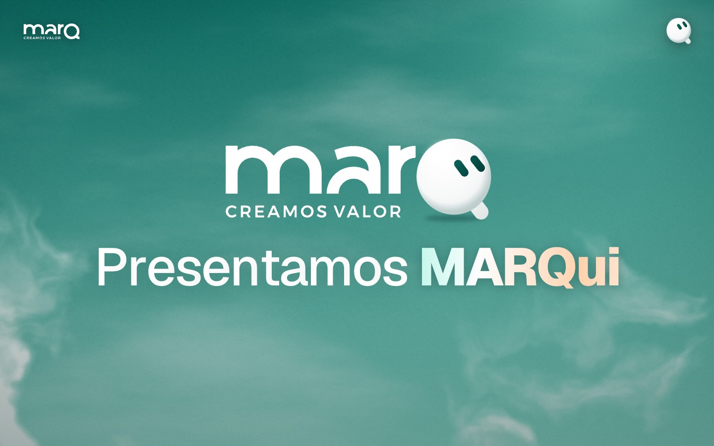

## Sobre el proyecto

Este repositorio es el trabajo de una **instancia evaluativa de la materia Agilidad avanzada**. Para la consigna, el equipo trabajó como una **consultora**: tomamos a **MARQ**, una desarrolladora inmobiliaria de Resistencia, y nos enfocamos en algunos de sus problemas. Con **design thinking** (entender, definir, idear y prototipar) planteamos soluciones para ellos.

El resultado es **MARQui**, un asistente con inteligencia artificial para el equipo de MARQ, y su módulo **MARQador**. Lo presentamos con esta página web interactiva: cada función se muestra funcionando, no solo descripta.

> Las conversaciones, los nombres, las fotos y los números de la presentación son ilustrativos. La página no está conectada a WhatsApp, a la web de MARQ ni a Mercado Pago. Las caras de los clientes son generadas con IA (`public/assets/clientes/`): no son personas reales.

## El problema

MARQ recibe sus consultas por **dos WhatsApp** (la línea de pauta y la de clientes) y por el formulario de la web. En las entrevistas y el análisis aparecieron estos dolores:

- **Se responde lo mismo todo el día.** Unas 4 horas diarias se van en contestar «precio?» y preguntas parecidas.
- **Las consultas se enfrían.** Responder después de la primera hora baja mucho las chances de avanzar.
- **Lo importante se pierde.** Un cliente que vuelve o un referido queda enterrado entre cien mensajes.
- **No hay datos para decidir.** En un lanzamiento llegaron 500 consultas y no hubo forma de saber cuántas personas podían comprar sin leer los chats uno por uno. La pauta se decide por volumen, no por calidad.
- **Las tareas se hacen dos veces.** Precios, listas y la web se actualizan a mano.
- **Ya probaron un bot y no funcionó:** la gente se dio cuenta y dejó de contestar.

Además, el equipo no quiere aprender un sistema nuevo: trabaja en WhatsApp Web y ahí tiene que estar la solución.

## La solución: MARQui

MARQui es **un compañero de trabajo que vive en el WhatsApp que el equipo ya usa**. Lee cada consulta, prepara la respuesta y avisa lo importante, pero **nunca le habla al cliente**: el que responde siempre es una persona de MARQ.

<p align="center">
  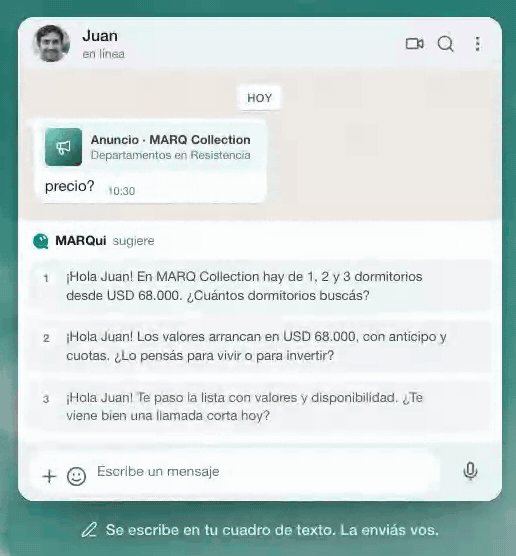
  &nbsp;
  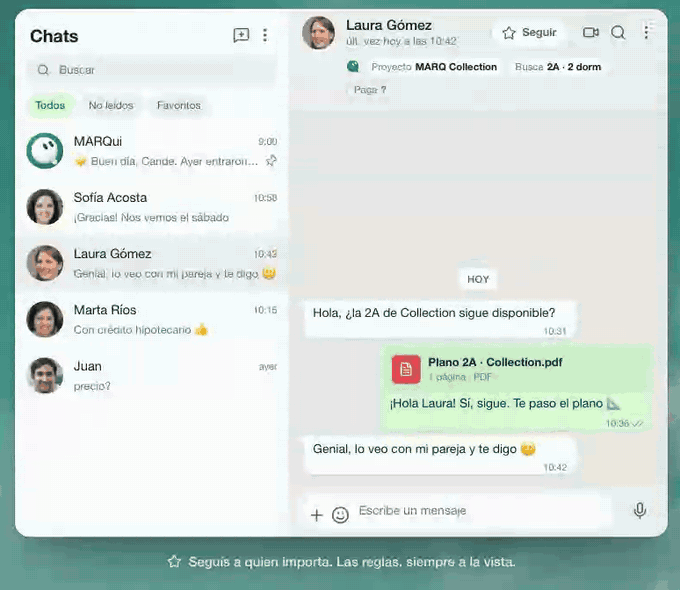
</p>

| Qué hace | Cómo se ve |
| --- | --- |
| **Te sugiere qué responder.** Tres respuestas con el tono de MARQ en cada chat. Elegís una, la ajustás y la mandás vos. | Primera animación, arriba |
| **Tu día, resumido cada mañana.** A las 9 llega lo que pasó ayer y lo que no puede esperar hoy, con un botón para abrir cada chat. | 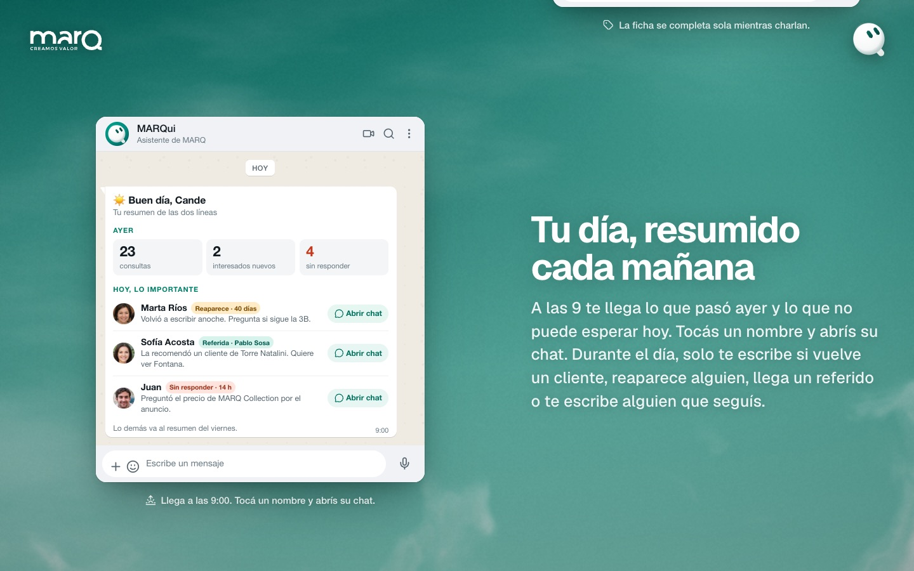 |
| **Seguí a los que importan.** Marcás a un cliente importante con una estrella y MARQui te avisa apenas escribe. También le pedís tareas que se repiten («todos los días a las 18 pasame…»), que quedan a la vista en sus **Reglas**. | Segunda animación, arriba |
| **Aprende cómo trabaja MARQ.** Se nutre de los chats, los audios, la pauta, los Excel, los documentos de Drive y la web. Nadie carga nada en otro sistema. | 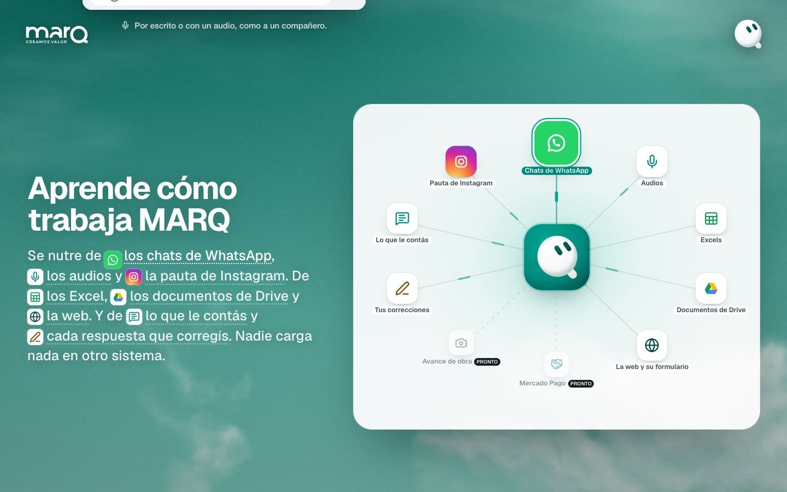 |
| **También en el celular.** Es un contacto más: le preguntás, le mandás un audio o le reenviás un mensaje. | 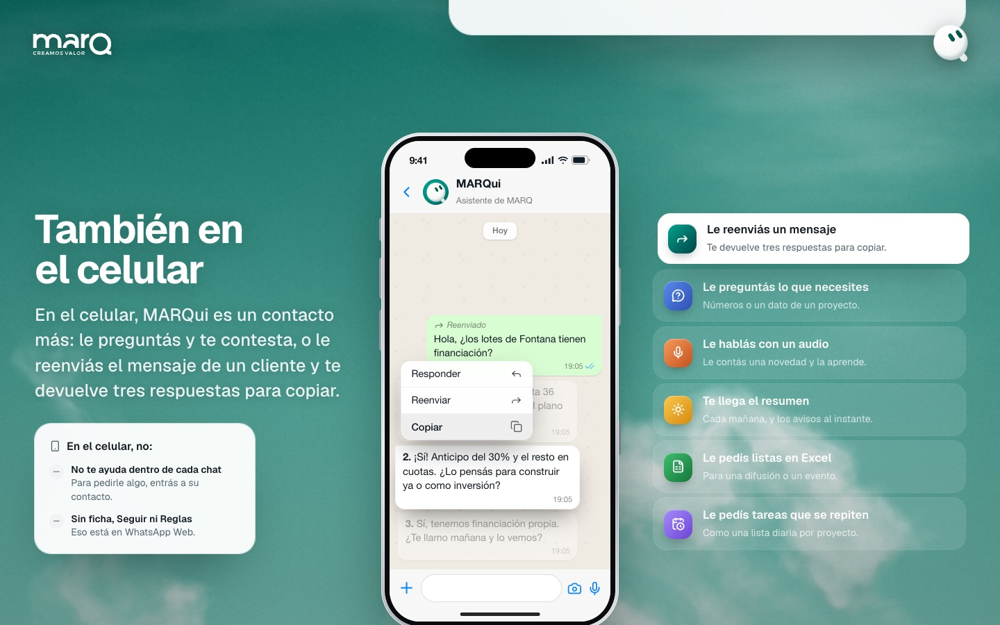 |

Además arma la **ficha de cada cliente** mientras charlan (proyecto, qué busca, cómo paga, etapa). Si falta un dato, lo pregunta de forma natural dentro de una respuesta, sin encuestas. También responde preguntas sobre los datos, con números o con la lista en Excel.

### Lo que gana el equipo

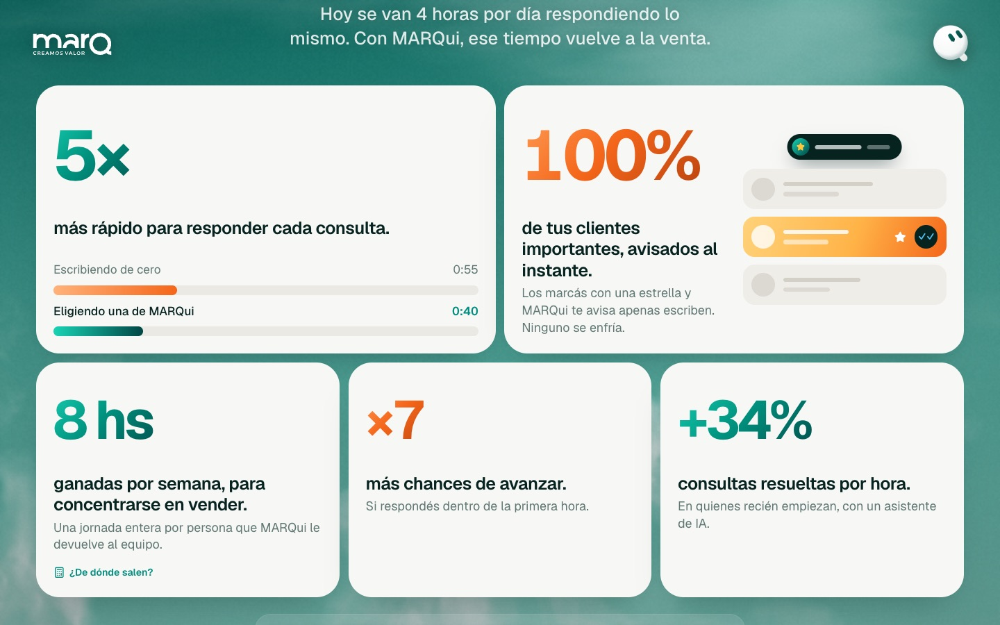

- **5× más rápido** para responder cada consulta: de 3 min 10 s escribiendo de cero a 40 s eligiendo una sugerencia.
- **8 horas por semana por persona** que vuelven a la venta: 4 h por día respondiendo, la mitad son repetidas (2 h), con MARQui eso baja a 24 min. Se ahorran 1 h 36 min por día, × 5 días = 8 h.
- **×7 más chances de avanzar** si se responde dentro de la primera hora ([Harvard Business Review, 2011](https://scholarsarchive.byu.edu/facpub/9711)).
- **+34 % de consultas resueltas por hora** en quienes recién empiezan, con un asistente de IA ([NBER, 2023](https://www.nber.org/papers/w31161)).

El 5× y las 8 h son un caso estimado para MARQ. La propuesta es medirlos de verdad: dos semanas sin sugerencias como línea de base y después comparar.

### De tu lado, bajo tu control


No es un bot, no hay encuestas y nada cambia sin tu OK: si algo nuevo contradice lo que sabía (un precio, por ejemplo), MARQui pregunta antes de reemplazarlo.

### Un día con MARQui y dónde aparece

| Un día con MARQui | En WhatsApp Web |
| --- | --- |
| 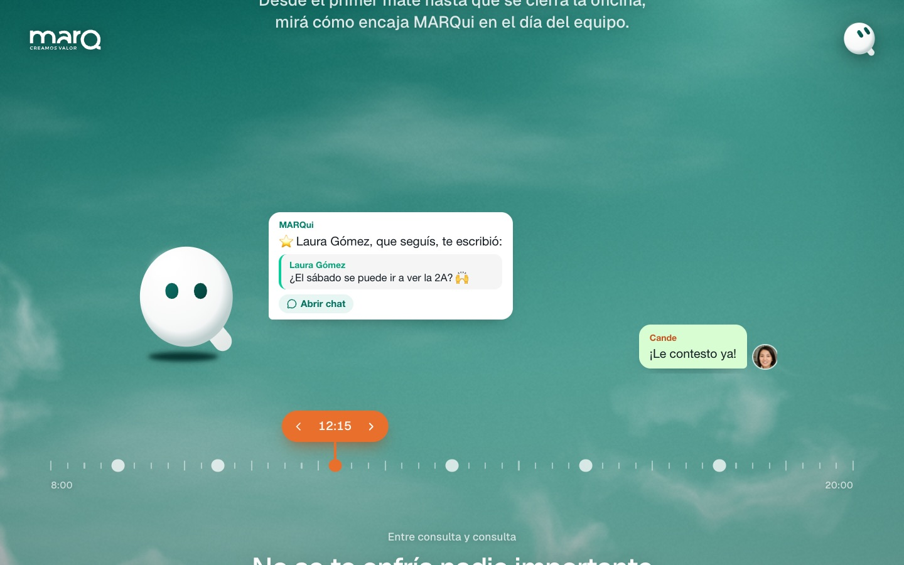 | 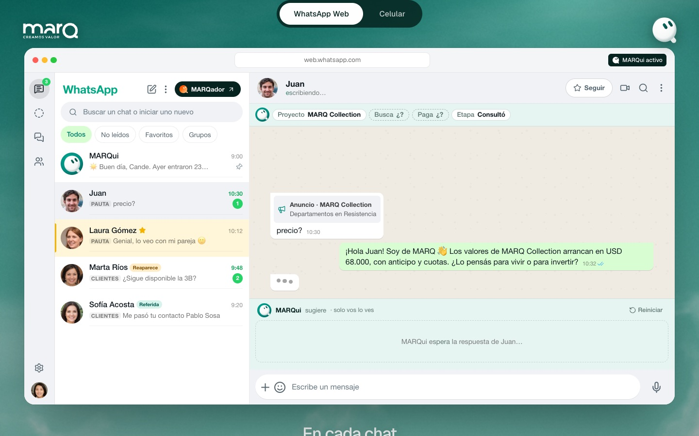 |

La línea de tiempo recorre un viernes, de 9:00 a 18:00, como una conversación entre Cande (del equipo) y MARQui. La demo de WhatsApp Web se puede tocar: elegís una respuesta, la enviás y la ficha del cliente se completa sola.

## MARQador, el módulo de datos

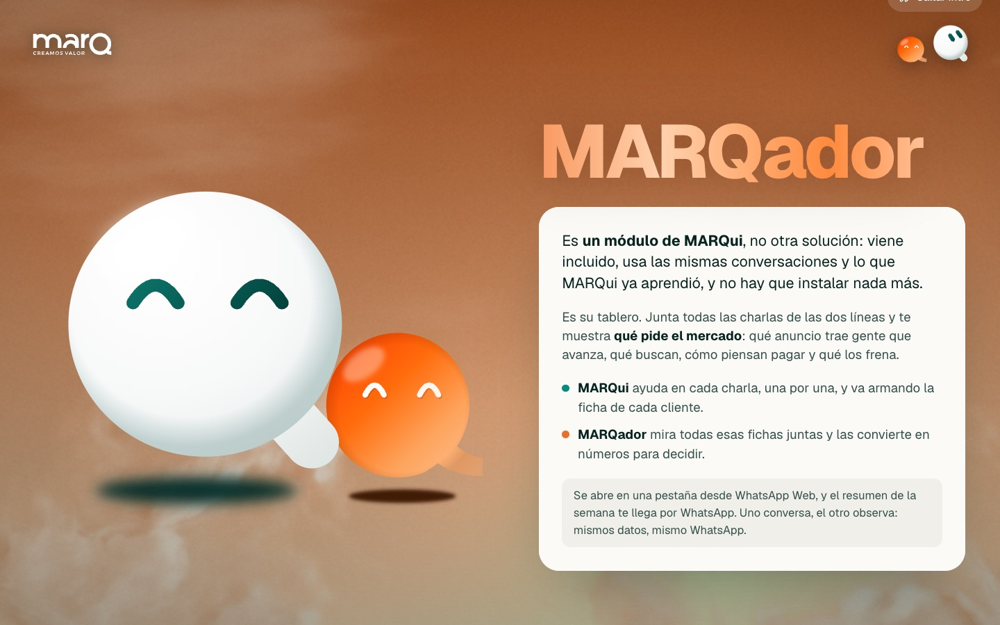

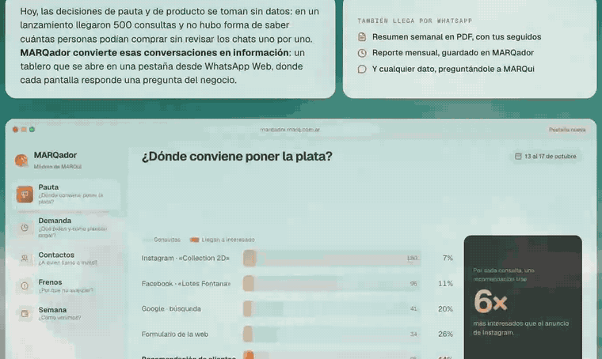

**MARQador es un módulo de MARQui**, no otra solución: viene incluido y usa las mismas conversaciones. MARQui ayuda en cada charla, una por una; MARQador junta todas las fichas y muestra **qué pide el mercado**. Se abre en una pestaña desde WhatsApp Web y tiene cinco pantallas, cada una con una pregunta del negocio:

1. **Pauta:** ¿dónde conviene poner la plata?
2. **Demanda:** ¿qué piden y cómo piensan pagar?
3. **Contactos:** ¿a quién llamo o invito?
4. **Frenos:** ¿por qué no avanzan?
5. **Semana:** ¿cómo venimos?

El resumen semanal también llega por WhatsApp, en PDF.

## Cómo llega MARQui a MARQ

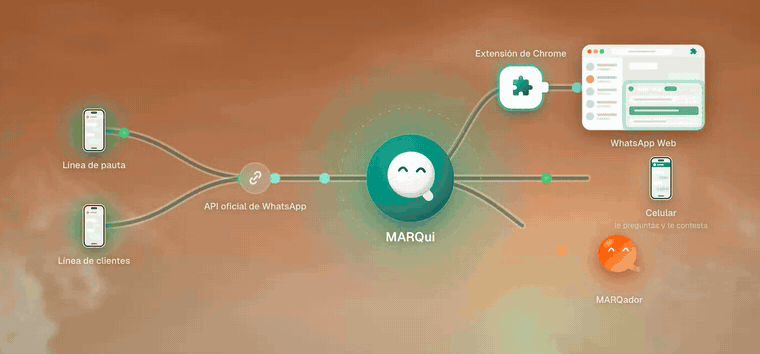

Las dos líneas siguen funcionando igual que hoy. MARQui recibe los mensajes por la **API oficial de WhatsApp** (en modo coexistencia, el número sigue en el celular) y aparece donde el equipo trabaja:

- en **WhatsApp Web**, mediante una **extensión de Chrome**, la única instalación;
- en el **celular**, como un contacto más;
- en **MARQador**, en una pestaña aparte.

Si la extensión dejara de funcionar, MARQui sigue disponible por el contacto.

## Lo que viene

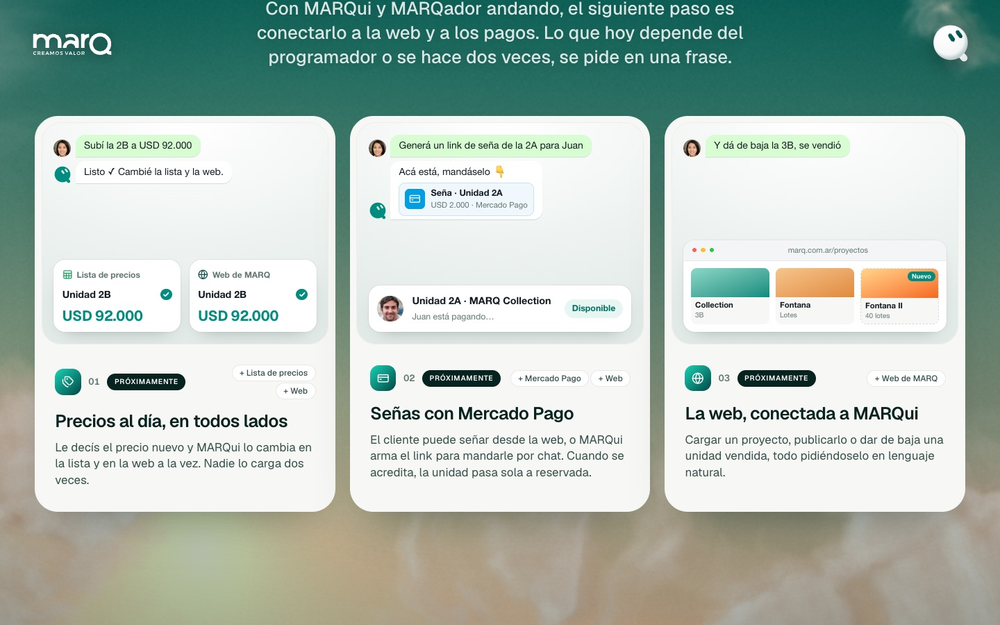

Con MARQui y MARQador andando, el siguiente paso son tres integraciones, todas pedidas en lenguaje natural:

- **Precios al día:** cambiar un precio y que se actualice en la lista y en la web a la vez.
- **Señas con Mercado Pago:** desde la web o con un link que arma MARQui; al acreditarse, la unidad pasa sola a reservada.
- **La web conectada a MARQui:** cargar o publicar un proyecto y dar de baja una unidad vendida.

## Ver la presentación

Requiere Node.js 20.19+ o 22.12+ y npm.

```sh
npm ci
npm run dev
```

Abrí **http://127.0.0.1:4173/**. Para presentar, en «Un día con MARQui» se avanza con las flechas ← →.

El tablero completo de MARQador, como se abriría en una pestaña, está en **http://127.0.0.1:4173/?app=marqador**.

```sh
npm run build     # verifica tipos y compila en dist/
npm run preview
```

`.npmrc` activa `legacy-peer-deps` por un conflicto de una dependencia opcional de `@vitejs/plugin-react` (`@babel/core` 7 contra 8).

La pestaña **Design thinking** está oculta hasta que se presente. Para mostrarla, cambiá `SHOW_THINKING` a `true` en [src/App.tsx](src/App.tsx).

## Documentos del proceso

| Documento | Contenido |
| --- | --- |
| [docs/marqui-contexto.md](docs/marqui-contexto.md) | Alcance, reglas, decisiones tomadas y verificaciones técnicas |
| [docs/marqui-referencia.md](docs/marqui-referencia.md) | Referencia del producto y tecnología propuesta |
| [docs/fuentes.md](docs/fuentes.md) | Fuentes y referencias consultadas |
| [docs/propuesta.md](docs/propuesta.md) | Propuesta anterior (MARQ Alloy) |

## Diseño y tecnología

- **Vite + React + TypeScript + Tailwind CSS v4**, con animaciones de Motion y GSAP.
- **Arc** (`https://uiarc.dev`) y **shadcn/ui** para componentes, en `src/components/arc` y `src/components/ui`.
- **CloudShader** (`src/components/ui/cloud-shader.tsx`): un cielo WebGL que cambia de hora a medida que avanza la presentación.
- MARQui y MARQador son personajes vectoriales animados: parpadean, miran y siguen el cursor (`src/components/marqui/marqui-live.tsx`).
- La tipografía escala con el ancho de pantalla, para leerse desde lejos en una TV 2K.
- Respeta `prefers-reduced-motion`: con la opción activada, las animaciones quedan quietas.

## Estructura

| Ruta | Contenido |
| --- | --- |
| `src/App.tsx` | Orden de las secciones |
| `src/components/marqui/` | Secciones, demos de WhatsApp Web y MARQador, personajes |
| `src/components/ui/` | shadcn y CloudShader |
| `src/components/arc/` | Componentes de Arc |
| `public/assets/` | Logos, mascota y fotos de clientes (generadas con IA) |
| `video/marqui/` | Composición de los videos ([README](video/marqui/README.md)) |
| `docs/` | Documentos del proceso y capturas de la presentación |
